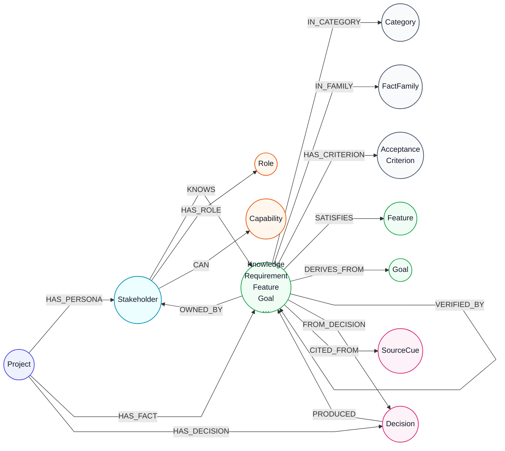

# Neo4j scenario graph model

Domain graph used by **neo4j** and **hybrid** modes when a YAML scenario package + persona is selected. Packages under `scenarios/` are ground truth; reindex materializes (and replaces) nodes marked `ScenarioPack`.

Authoring taxonomy / SRS coverage: `.agents/skills/scenario-author/references/ieee-srs-coverage.md`.

## Package → graph

```text
ScenarioPackage
  ├─ personas / known_fact_ids
  ├─ facts (category, acceptance_criteria, source_refs,
  │         satisfies_ids / derives_from_ids / depends_on_ids)
  └─ gaps.decisions
        │
        ▼
app.scenarios.neo4j_graph.fact_kind_and_label()
  functional|REQ     → Requirement
  feature|FEAT       → Feature
  goal|GOAL          → Goal
  constraint|BR      → Constraint
  assumption|ASM     → Assumption
  dependency|DEP     → Dependency
  limitation|LIM     → Limitation
  workflow|WF        → Task
  use_case|UC        → UseCase
  interface|IF       → ExternalInterface
  data|DATA          → DataEntity
  performance|PERF   → PerformanceRequirement
  usability|USE      → UsabilityRequirement
  quality|NFR|SEC    → QualityAttribute
  design_constraint  → DesignConstraint
  standard|STD       → Standard
  verification|VER   → VerificationMethod
  glossary|GLOSS     → GlossaryTerm
  reference|REF      → Reference
  contextual         → RequirementNode
        │
        └─► Neo4j: ScenarioPack + typed label, hubs, edges, embeddings
```

Vector mode uses Chroma `scenario_facts` (same kind/sheet labels) via `app/indexing.py` — not this graph.

## Node types

| Label(s) | Key | Purpose |
| --- | --- | --- |
| `ScenarioPack`:`Project` | `node_id` = `scenario:{slug}:project` | Package root (title, brief, status) |
| `ScenarioPack`:`Stakeholder` | `key` + scenario | Chat stakeholder |
| `ScenarioPack`:`Requirement` / `Feature` / `Goal` / `Constraint` / `Assumption` / `Dependency` / `Limitation` / `Task` / `UseCase` / `ExternalInterface` / `DataEntity` / `QualityAttribute` / `PerformanceRequirement` / `UsabilityRequirement` / `DesignConstraint` / `Standard` / `VerificationMethod` / `GlossaryTerm` / `Reference` / `RequirementNode` | `node_id` = `scenario:{slug}:{fact_id}` | Typed knowledge (embedded) |
| `ScenarioPack`:`Category` | `name` + `scenario_slug` | Hub for `IN_CATEGORY` |
| `ScenarioPack`:`FactFamily` | `name` + `scenario_slug` | Hub for REQ/FEAT/GOAL/BR/ASM/… |
| `ScenarioPack`:`AcceptanceCriterion` | `criterion_id` + scenario | From `acceptance_criteria[]` |
| `ScenarioPack`:`Role` | `name` | System-role vocabulary |
| `ScenarioPack`:`Capability` | `name` | Admin capability verbs |
| `ScenarioPack`:`Decision` | `decision_id` + scenario | Instructor gap decision |
| `ScenarioPack`:`SourceCue` | `cue_id` + `file` + scenario | Transcript provenance |

Instructor-only open questions and `evaluation.yaml` are **not** indexed.

## Relationships

| Type | From → To | Meaning |
| --- | --- | --- |
| `HAS_PERSONA` | Project → Stakeholder | Persona belongs to package |
| `HAS_FACT` | Project → knowledge | Fact belongs to package |
| `HAS_DECISION` | Project → Decision | Decision recorded for package |
| `KNOWS` | Stakeholder → knowledge | Persona may disclose this fact |
| `OWNED_BY` | knowledge → Stakeholder | Reverse ownership for “who owns” traversal |
| `HAS_ROLE` | Stakeholder → Role | In-system authority class |
| `CAN` | Stakeholder → Capability | Concrete admin verb |
| `IN_CATEGORY` | knowledge → Category | Domain grouping |
| `IN_FAMILY` | knowledge → FactFamily | REQ/FEAT/GOAL/… grouping |
| `HAS_CRITERION` | knowledge → AcceptanceCriterion | Testable criterion |
| `SATISFIES` | Requirement/NFR → Feature | From `satisfies_ids` |
| `DERIVES_FROM` | Requirement → Goal (etc.) | From `derives_from_ids` |
| `DEPENDS_ON` | knowledge → knowledge | From `depends_on_ids` |
| `VERIFIED_BY` | knowledge → VerificationMethod | From VER link fields or `depends_on` → VER-* |
| `FROM_DECISION` / `PRODUCED` | Fact ↔ Decision | Provenance |
| `CITED_FROM` | knowledge → SourceCue | Transcript citation |

### Retrieval expansion order

Neo4j search expands related nodes in this priority (then fills to limit):

1. `DEPENDS_ON` / `SATISFIES` / `DERIVES_FROM` / `VERIFIED_BY` / `OWNED_BY`
2. `HAS_CRITERION`
3. Same `Category` / `FactFamily` (filler only)

Scenario vector hits prefer `scenario_pack_embeddings` (when the Neo4j server supports vector indexes), filtered to the persona `KNOWS` set; otherwise cosine over known embeddings.

## Coverage gaps (authoring)

| Desired | Status |
| --- | --- |
| Typed Requirement / Feature / Goal / Constraint / … | Mapped via category + id prefix |
| Acceptance criteria | Mapped |
| Stakeholder disclosure / ownership | `KNOWS` + `OWNED_BY` |
| Trace links | `SATISFIES` / `DERIVES_FROM` / `DEPENDS_ON` / `VERIFIED_BY` |
| Risk / Budget / Milestone entities | Not modeled |
| `UserClass` beyond Stakeholder/Role | Partial |

Author tip: link `VER-*` facts with `depends_on_ids` / `satisfies_ids` / `derives_from_ids` to the FRs they cover so `VERIFIED_BY` is emitted.

## Visual map



## Reindex

```bash
python scripts/reindex_scenarios.py
# or POST /api/admin/scenarios/reindex
```
