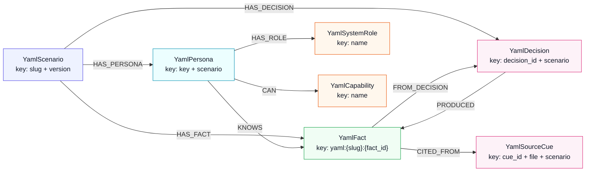

# YAML scenario graph model (Neo4j)

Generalized graph used by **neo4j** / **hybrid** modes when a YAML scenario + persona is selected. Excel RAG nodes remain separate; reindex replaces only `Yaml*` labels.

## Node types

| Label | Key | Purpose |
| --- | --- | --- |
| `YamlScenario` | `slug` + `version` | Package root (title, brief, status) |
| `YamlPersona` | `key` + scenario | Chat stakeholder; carries `system_role` / capability list props |
| `YamlFact` | `node_id` (`yaml:{slug}:{fact_id}`) | Student-visible knowledge (embedded for vector search) |
| `YamlSystemRole` | `name` | Shared vocabulary: `platform_admin`, `operator`, `approver`, `end_user`, `hybrid` |
| `YamlCapability` | `name` | Shared admin capability verbs (`publish_listings`, …) |
| `YamlDecision` | `decision_id` + scenario | Instructor gap decision that produced facts |
| `YamlSourceCue` | `cue_id` + `file` + scenario | Transcript provenance for confirmed/clarified facts |

Instructor-only `gaps.yaml` open questions and `evaluation.yaml` are **not** indexed.

## Relationships

| Type | From → To | Meaning |
| --- | --- | --- |
| `HAS_PERSONA` | Scenario → Persona | Persona belongs to package |
| `HAS_FACT` | Scenario → Fact | Fact belongs to package |
| `HAS_DECISION` | Scenario → Decision | Decision recorded for package |
| `KNOWS` | Persona → Fact | Persona may disclose this fact |
| `HAS_ROLE` | Persona → SystemRole | In-system authority class |
| `CAN` | Persona → Capability | Concrete admin verb |
| `FROM_DECISION` | Fact → Decision | Fact provenance via gap decision |
| `PRODUCED` | Decision → Fact | Inverse of `FROM_DECISION` |
| `CITED_FROM` | Fact → SourceCue | Transcript cue citation |

## Visual map (node types + relationships)



## Reindex

```bash
python scripts/reindex_scenarios.py
# or POST /api/admin/scenarios/reindex
```
