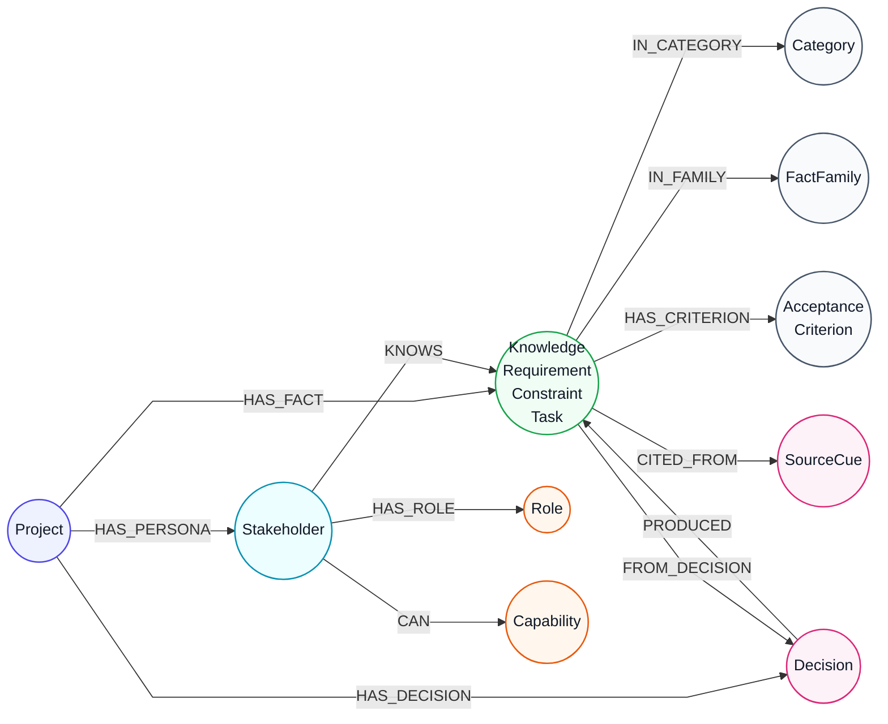

# Scenario domain graph + vector model (Neo4j / Chroma)

Generalized domain model used by **neo4j** / **hybrid** / **vector** modes when a scenario package + persona is selected. Excel RAG nodes remain separate; reindex replaces only nodes marked `ScenarioPack` (and clears legacy `Yaml*` labels if present).

Stored names intentionally avoid `Yaml*` / `yaml:` prefixes — labels and sheet metadata align with the traditional Excel model.

## Translation workflow (package facts → stores)

```text
ScenarioPackage
  ├─ personas / known_fact_ids
  ├─ knowledge facts (category, acceptance_criteria, source_refs, decision_id)
  └─ gaps.decisions
        │
        ▼
app.scenarios.neo4j_graph.fact_kind_and_label()
  functional|REQ → Requirement
  constraint|BR  → Constraint
  ASM            → Constraint (assumption family)
  workflow|WF    → Task
  contextual     → RequirementNode
  non_functional → QualityScenario / Qual_Scenario
        │
        ├─► Neo4j: ScenarioPack + typed label, domain hubs/edges, embeddings
        └─► Chroma: scenario_facts docs with Excel sheet/kind metadata
```

## Neo4j node types

| Label(s) | Key | Purpose |
| --- | --- | --- |
| `ScenarioPack`:`Project` | `node_id` = `scenario:{slug}:project` | Package root (title, brief, status) |
| `ScenarioPack`:`Stakeholder` | `key` + scenario | Chat stakeholder |
| `ScenarioPack`:`Requirement` / `Constraint` / `Task` / `QualityScenario` / `RequirementNode` | `node_id` = `scenario:{slug}:{fact_id}` | Typed knowledge (embedded) |
| `ScenarioPack`:`Category` | `name` + `scenario_slug` | Hub for `IN_CATEGORY` |
| `ScenarioPack`:`FactFamily` | `name` + `scenario_slug` | Hub for REQ/BR/ASM/WF |
| `ScenarioPack`:`AcceptanceCriterion` | `criterion_id` + scenario | From `acceptance_criteria[]` |
| `ScenarioPack`:`Role` | `name` | System-role vocabulary |
| `ScenarioPack`:`Capability` | `name` | Admin capability verbs |
| `ScenarioPack`:`Decision` | `decision_id` + scenario | Instructor gap decision |
| `ScenarioPack`:`SourceCue` | `cue_id` + `file` + scenario | Transcript provenance |

Instructor-only open questions and `evaluation.yaml` are **not** indexed.

## Relationships

| Type | From → To | Meaning |
| --- | --- | --- |
| `HAS_PERSONA` | Project → Stakeholder | Persona belongs to package |
| `HAS_FACT` | Project → knowledge node | Fact belongs to package |
| `HAS_DECISION` | Project → Decision | Decision recorded for package |
| `KNOWS` | Stakeholder → knowledge | Persona may disclose this fact |
| `HAS_ROLE` | Stakeholder → Role | In-system authority class |
| `CAN` | Stakeholder → Capability | Concrete admin verb |
| `IN_CATEGORY` | knowledge → Category | Domain grouping |
| `IN_FAMILY` | knowledge → FactFamily | REQ/BR/ASM/WF grouping |
| `HAS_CRITERION` | knowledge → AcceptanceCriterion | Testable criterion |
| `FROM_DECISION` / `PRODUCED` | Fact ↔ Decision | Provenance |
| `CITED_FROM` | knowledge → SourceCue | Transcript citation |

## Vector store (Chroma `scenario_facts`)

Each `(persona, fact)` document uses the same kind/sheet mapping:

| Metadata | Example |
| --- | --- |
| `source` | `scenario` |
| `sheet` | `Requirement`, `Constraint`, `Task`, `Qual_Scenario`, … |
| `sheet_type` / `kind` | `requirement`, `constraint`, `workflow`, … |
| `family` | `REQ`, `BR`, `ASM`, `WF` |
| `node_id` | `scenario:{slug}:{fact_id}` |
| doc id | `scenario:{slug}:{version}:{persona}:{fact_id}` |

Document text includes project, stakeholder, sheet/kind, statement, and acceptance criteria — not `yaml` tokens.

## Gaps vs traditional Excel Neo4j model

| Excel model | What scenario packages provide | Status |
| --- | --- | --- |
| `Requirement` / `Constraint` typed rows | `KnowledgeFact.category` + id prefix | **Mapped** |
| Acceptance criteria on rows | `acceptance_criteria[]` | **Mapped** |
| Stakeholder ownership (`OWNED_BY`) | Persona `KNOWS` | **Partial** |
| Explicit `Relationships` sheet | No authored fact↔fact links | **Partial** (category/family hubs) |
| `Feature` + `SATISFIES` | No Feature entity | **Gap** |
| `Goal` / `Risk` / `Budget` / `Milestone` | Not modeled | **Gap** |

## Missing nodes for IEEE / ISO/IEC/IEEE 29148 SRS coverage

Relative to a typical SRS (29148 §9.6 / classic IEEE 830-style outline), the current graph covers **stakeholders**, **typed requirements/constraints**, **workflows (as Task)**, **acceptance criteria**, and **provenance**. These node types are still missing (or collapsed into generic facts) if the graph is meant to represent SRS portions:

| IEEE SRS portion (29148) | Suggested node(s) | Status now |
| --- | --- | --- |
| Purpose / Scope | `Purpose`, `Scope` (or structured props on `Project`) | **Missing** — only free-text `Project.brief` |
| Definitions / acronyms | `GlossaryTerm` | **Missing** |
| References | `Reference` (docs/standards) | **Missing** — `SourceCue` is interview provenance, not SRS refs |
| Product perspective / context | `ExternalSystem`, `ContextBoundary` | **Missing** |
| Product functions | `Feature` (or `ProductFunction`) | **Missing** |
| User characteristics | `UserClass` | **Partial** — `Stakeholder` / `Role` only |
| Limitations | `Limitation` | **Missing** — folded into `Constraint` if present at all |
| Assumptions and dependencies | `Assumption`, `Dependency` | **Missing** — ASM facts become `Constraint`, not first-class |
| Apportioning (deferred/allocated) | `RequirementAllocation` or status on req | **Missing** |
| External interfaces | `UserInterface`, `HardwareInterface`, `SoftwareInterface`, `CommInterface` | **Missing** |
| Functions (detailed FR) | `FunctionalRequirement` (distinct from Feature) | **Partial** — all FRs are plain `Requirement` |
| Usability / performance | `UsabilityRequirement`, `PerformanceRequirement` | **Missing** — only generic `QualityScenario` for some NFRs |
| Logical database requirements | `DataEntity`, `DataRequirement` | **Missing** |
| Design constraints / standards compliance | `DesignConstraint`, `Standard` | **Partial** — single `Constraint` bucket |
| Software system attributes | `QualityAttribute` (reliability, security, …) | **Partial** — `QualityScenario` only |
| Verification | `VerificationMethod` (test/demo/analysis/inspection) | **Missing** — criteria exist, methods do not |
| Supporting info / use cases | `UseCase`, `OperationalScenario` | **Missing** — workflows are `Task`, not use cases |
| Traceability matrix edges | `SATISFIES`, `DERIVES_FROM`, `VERIFIED_BY`, `DEPENDS_ON` | **Missing** — hubs only (`IN_CATEGORY` / `IN_FAMILY`) |

Highest-value additions to approximate an SRS subgraph:

1. `Feature` + `SATISFIES` (Feature → Requirement)
2. `Goal` + `DERIVES_FROM` (Requirement → Goal)
3. `Assumption` / `Dependency` (split from Constraint)
4. `ExternalInterface` (user/hardware/software/communications)
5. `DataEntity` / logical data requirements
6. `UseCase` (linked to Stakeholder + Requirement)
7. `VerificationMethod` + `VERIFIED_BY`
8. `GlossaryTerm` + `Reference` for intro/supporting sections

## Visual map

Circular nodes, straight directed edges:



## Reindex

```bash
python scripts/reindex_scenarios.py
# or POST /api/admin/scenarios/reindex
```
