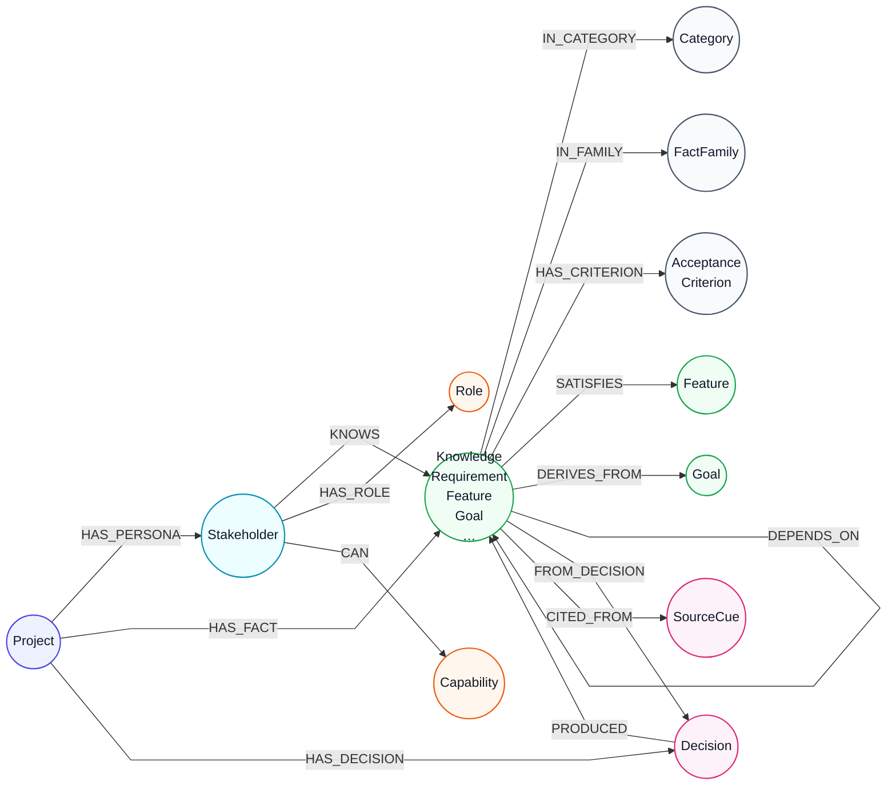

# Scenario domain graph + vector model (Neo4j / Chroma)

Generalized domain model used by **neo4j** / **hybrid** / **vector** modes when a scenario package + persona is selected. Excel RAG nodes remain separate; reindex replaces only nodes marked `ScenarioPack` (and clears legacy `Yaml*` labels if present).

Stored names intentionally avoid `Yaml*` / `yaml:` prefixes — labels and sheet metadata align with the traditional Excel model.

Authoring taxonomy and SRS coverage rules: `.agents/skills/scenario-author/references/ieee-srs-coverage.md`.

## Translation workflow (package facts → stores)

```text
ScenarioPackage
  ├─ personas / known_fact_ids
  ├─ knowledge facts (category, acceptance_criteria, source_refs,
  │                   satisfies_ids / derives_from_ids / depends_on_ids)
  └─ gaps.decisions
        │
        ▼
app.scenarios.neo4j_graph.fact_kind_and_label()
  functional|REQ     → Requirement
  feature|FEAT       → Feature
  goal|GOAL          → Goal
  constraint|BR      → Constraint
  assumption|ASM     → Assumption
  dependency|DEP     → Dependency
  limitation|LIM     → Limitation
  workflow|WF        → Task
  use_case|UC        → UseCase
  interface|IF       → ExternalInterface
  data|DATA          → DataEntity
  performance|PERF   → PerformanceRequirement
  usability|USE      → UsabilityRequirement
  quality|NFR|SEC    → QualityAttribute
  design_constraint  → DesignConstraint
  standard|STD       → Standard
  verification|VER   → VerificationMethod
  glossary|GLOSS     → GlossaryTerm
  reference|REF      → Reference
  contextual         → RequirementNode
        │
        ├─► Neo4j: ScenarioPack + typed label, domain hubs/edges, embeddings
        └─► Chroma: scenario_facts docs with Excel sheet/kind metadata
```

## Neo4j node types

| Label(s) | Key | Purpose |
| --- | --- | --- |
| `ScenarioPack`:`Project` | `node_id` = `scenario:{slug}:project` | Package root (title, brief, status) |
| `ScenarioPack`:`Stakeholder` | `key` + scenario | Chat stakeholder |
| `ScenarioPack`:`Requirement` / `Feature` / `Goal` / `Constraint` / `Assumption` / `Dependency` / `Limitation` / `Task` / `UseCase` / `ExternalInterface` / `DataEntity` / `QualityAttribute` / `PerformanceRequirement` / `UsabilityRequirement` / `DesignConstraint` / `Standard` / `VerificationMethod` / `GlossaryTerm` / `Reference` / `RequirementNode` | `node_id` = `scenario:{slug}:{fact_id}` | Typed knowledge (embedded) |
| `ScenarioPack`:`Category` | `name` + `scenario_slug` | Hub for `IN_CATEGORY` |
| `ScenarioPack`:`FactFamily` | `name` + `scenario_slug` | Hub for REQ/FEAT/GOAL/BR/ASM/… |
| `ScenarioPack`:`AcceptanceCriterion` | `criterion_id` + scenario | From `acceptance_criteria[]` |
| `ScenarioPack`:`Role` | `name` | System-role vocabulary |
| `ScenarioPack`:`Capability` | `name` | Admin capability verbs |
| `ScenarioPack`:`Decision` | `decision_id` + scenario | Instructor gap decision |
| `ScenarioPack`:`SourceCue` | `cue_id` + `file` + scenario | Transcript provenance |

Instructor-only open questions and `evaluation.yaml` are **not** indexed.

## Relationships

| Type | From → To | Meaning |
| --- | --- | --- |
| `HAS_PERSONA` | Project → Stakeholder | Persona belongs to package |
| `HAS_FACT` | Project → knowledge node | Fact belongs to package |
| `HAS_DECISION` | Project → Decision | Decision recorded for package |
| `KNOWS` | Stakeholder → knowledge | Persona may disclose this fact |
| `HAS_ROLE` | Stakeholder → Role | In-system authority class |
| `CAN` | Stakeholder → Capability | Concrete admin verb |
| `IN_CATEGORY` | knowledge → Category | Domain grouping |
| `IN_FAMILY` | knowledge → FactFamily | REQ/FEAT/GOAL/… grouping |
| `HAS_CRITERION` | knowledge → AcceptanceCriterion | Testable criterion |
| `SATISFIES` | Requirement/NFR → Feature | From `satisfies_ids` |
| `DERIVES_FROM` | Requirement → Goal (etc.) | From `derives_from_ids` |
| `DEPENDS_ON` | knowledge → knowledge | From `depends_on_ids` |
| `FROM_DECISION` / `PRODUCED` | Fact ↔ Decision | Provenance |
| `CITED_FROM` | knowledge → SourceCue | Transcript citation |

## Vector store (Chroma `scenario_facts`)

Each `(persona, fact)` document uses the same kind/sheet mapping:

| Metadata | Example |
| --- | --- |
| `source` | `scenario` |
| `sheet` | `Requirement`, `Feature`, `Constraint`, `Assumption`, `Qual_Scenario`, … |
| `sheet_type` / `kind` | `requirement`, `feature`, `constraint`, `assumption`, … |
| `family` | `REQ`, `FEAT`, `GOAL`, `BR`, `ASM`, … |
| `node_id` | `scenario:{slug}:{fact_id}` |
| doc id | `scenario:{slug}:{version}:{persona}:{fact_id}` |

Document text includes project, stakeholder, sheet/kind, statement, and acceptance criteria — not `yaml` tokens.

## Gaps vs traditional Excel Neo4j model

| Excel model | What scenario packages provide | Status |
| --- | --- | --- |
| `Requirement` / `Constraint` typed rows | `KnowledgeFact.category` + id prefix | **Mapped** |
| Acceptance criteria on rows | `acceptance_criteria[]` | **Mapped** |
| Stakeholder ownership (`OWNED_BY`) | Persona `KNOWS` | **Partial** |
| Explicit `Relationships` sheet | `SATISFIES` / `DERIVES_FROM` / `DEPENDS_ON` + hubs | **Partial** |
| `Feature` + `SATISFIES` | Optional `FEAT-*` + `satisfies_ids` | **Mapped** |
| `Goal` sheet | Optional `GOAL-*` | **Mapped** |
| `Risk` / `Budget` / `Milestone` | Not modeled | **Gap** |

## IEEE / ISO/IEC/IEEE 29148 SRS coverage

Relative to a typical SRS (29148 §9.6 / classic IEEE 830-style outline). Runtime labels exist when authors use the taxonomy in `ieee-srs-coverage.md`; thin packages may still omit records.

| IEEE SRS portion (29148) | Suggested node(s) | Status now |
| --- | --- | --- |
| Purpose / Scope | props on `Project` (`brief`) | **Partial** — free-text brief; author via scenario-author |
| Definitions / acronyms | `GlossaryTerm` | **Mapped** when `GLOSS-*` authored |
| References | `Reference` | **Mapped** when `REF-*` authored (`SourceCue` remains interview provenance) |
| Product perspective / context | `ExternalInterface` / contextual facts | **Partial** |
| Product functions | `Feature` | **Mapped** when `FEAT-*` authored |
| User characteristics | `UserClass` | **Partial** — `Stakeholder` / `Role` only |
| Limitations | `Limitation` | **Mapped** when `LIM-*` / `limitation` |
| Assumptions and dependencies | `Assumption`, `Dependency` | **Mapped** when `ASM`/`DEP` + categories |
| Apportioning (deferred/allocated) | status / gaps | **Partial** — via gaps + fact status |
| External interfaces | `ExternalInterface` | **Mapped** when `IF-*` authored |
| Functions (detailed FR) | `Requirement` (+ `SATISFIES` → Feature) | **Mapped** |
| Usability / performance | `UsabilityRequirement`, `PerformanceRequirement` | **Mapped** when authored |
| Logical database requirements | `DataEntity` | **Mapped** when `DATA-*` authored |
| Design constraints / standards | `DesignConstraint`, `Standard` | **Mapped** when authored |
| Software system attributes | `QualityAttribute` | **Mapped** when `NFR`/`SEC`/quality authored |
| Verification | `VerificationMethod` | **Mapped** when `VER-*` authored (`VERIFIED_BY` edge not yet emitted) |
| Supporting info / use cases | `UseCase` (+ `Task` for workflows) | **Mapped** when `UC-*` authored |
| Traceability matrix edges | `SATISFIES`, `DERIVES_FROM`, `DEPENDS_ON` | **Mapped** from fact link fields (`VERIFIED_BY` still missing) |

Authoring skill closes package gaps; reindex materializes the graph. Prefer remapping existing facts before inventing new ones.

## Visual map

Circular nodes, straight directed edges:



## Reindex

```bash
python scripts/reindex_scenarios.py
# or POST /api/admin/scenarios/reindex
```
