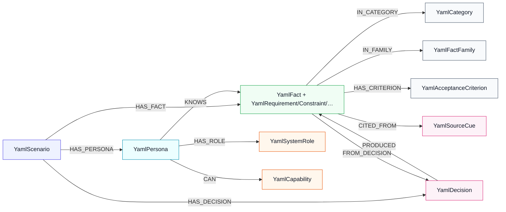

# YAML scenario graph model (Neo4j)

Generalized graph used by **neo4j** / **hybrid** modes when a YAML scenario + persona is selected. Excel RAG nodes remain separate; reindex replaces only `Yaml*` labels.

## Translation workflow (scenario facts → Neo4j)

```text
ScenarioPackage (YAML)
  ├─ personas / known_fact_ids
  ├─ knowledge facts (category, acceptance_criteria, source_refs, decision_id)
  └─ gaps.decisions (instructor provenance)
        │
        ▼
app.scenarios.neo4j_graph.build_scenario_graph_plan()
  ├─ map category / id prefix → domain kind + secondary label
  │    functional|REQ → YamlRequirement
  │    constraint|BR  → YamlConstraint
  │    ASM            → YamlAssumption (kind may still be constraint)
  │    workflow|WF    → YamlWorkflow
  │    contextual     → YamlContext
  │    non_functional → YamlNonFunctionalRequirement
  ├─ hub nodes: YamlCategory, YamlFactFamily
  ├─ YamlAcceptanceCriterion from acceptance_criteria[]
  └─ keep package edges: HAS_PERSONA, KNOWS, HAS_DECISION, CITED_FROM, …
        │
        ▼
RequirementsRAGNeo4j.upsert_scenario_graph()
  └─ wipe Yaml* subgraph → MERGE plan nodes/edges → embed YamlFact.text
```

## Node types

| Label | Key | Purpose |
| --- | --- | --- |
| `YamlScenario` | `slug` + `version` | Package root (title, brief, status) |
| `YamlPersona` | `key` + scenario | Chat stakeholder; carries `system_role` / capability list props |
| `YamlFact` | `node_id` (`yaml:{slug}:{fact_id}`) | Student-visible knowledge (embedded for vector search) |
| `YamlRequirement` / `YamlConstraint` / `YamlWorkflow` / `YamlAssumption` / `YamlContext` / `YamlNonFunctionalRequirement` / `YamlKnowledge` | same node as `YamlFact` | Excel-like **secondary** type labels (no collision with Excel `Requirement` sheet nodes) |
| `YamlCategory` | `name` + `scenario_slug` | Hub for `IN_CATEGORY` traversal |
| `YamlFactFamily` | `name` + `scenario_slug` | Hub for id-family traversal (`REQ` / `BR` / `ASM` / `WF`) |
| `YamlAcceptanceCriterion` | `criterion_id` + scenario | Materialized from `acceptance_criteria[]` |
| `YamlSystemRole` | `name` | Shared vocabulary: `platform_admin`, `operator`, `approver`, `end_user`, `hybrid` |
| `YamlCapability` | `name` | Shared admin capability verbs (`publish_listings`, …) |
| `YamlDecision` | `decision_id` + scenario | Instructor gap decision that produced facts |
| `YamlSourceCue` | `cue_id` + `file` + scenario | Transcript provenance for confirmed/clarified facts |

Instructor-only `gaps.yaml` open questions and `evaluation.yaml` are **not** indexed.

## Relationships

| Type | From → To | Meaning |
| --- | --- | --- |
| `HAS_PERSONA` | Scenario → Persona | Persona belongs to package |
| `HAS_FACT` | Scenario → Fact | Fact belongs to package |
| `HAS_DECISION` | Scenario → Decision | Decision recorded for package |
| `KNOWS` | Persona → Fact | Persona may disclose this fact (Excel `OWNED_BY`-ish) |
| `HAS_ROLE` | Persona → SystemRole | In-system authority class |
| `CAN` | Persona → Capability | Concrete admin verb |
| `IN_CATEGORY` | Fact → Category | Domain grouping for graph enrichment |
| `IN_FAMILY` | Fact → FactFamily | REQ/BR/ASM/WF family grouping |
| `HAS_CRITERION` | Fact → AcceptanceCriterion | Testable acceptance criterion |
| `FROM_DECISION` | Fact → Decision | Fact provenance via gap decision |
| `PRODUCED` | Decision → Fact | Inverse of `FROM_DECISION` |
| `CITED_FROM` | Fact → SourceCue | Transcript cue citation |

## Gaps vs traditional Excel Neo4j model

Excel loads typed sheets (`Project`, `Feature`, `Requirement`, `Constraint`, `Goal`, `Risk`, …) plus an explicit `Relationships` sheet (`HAS_CONSTRAINT`, `SATISFIES`, `OWNED_BY`, …). YAML stores the same training knowledge as flat facts. After translation:

| Excel model | What YAML scenarios provide | Status after rework |
| --- | --- | --- |
| `Requirement` / `Constraint` typed rows | `KnowledgeFact.category` + id prefix (`REQ`/`BR`/`ASM`/`WF`) | **Mapped** → secondary `YamlRequirement` / `YamlConstraint` / … |
| Acceptance criteria on requirement rows | `acceptance_criteria[]` | **Mapped** → `YamlAcceptanceCriterion` + `HAS_CRITERION` |
| Stakeholder ownership (`OWNED_BY`) | Persona `known_fact_ids` / `known_by` | **Partial** → `KNOWS` (persona→fact) |
| Explicit `Relationships` sheet | No first-class fact↔fact links in YAML | **Partial** → inferred via `IN_CATEGORY` / `IN_FAMILY` hubs |
| `Feature` + `SATISFIES` | Functional statements only; no Feature entity | **Gap** |
| `Goal` / `Risk` / `Budget` / `Milestone` / `Task` | Not modeled as entities | **Gap** |
| `Client` / `Role` sheets | `YamlPersona.system_role` + capabilities | **Partial** |

Retrieval consequence: Excel neo4j mode can follow authored edges like `HAS_CONSTRAINT`. YAML neo4j mode now enriches hits with same-category / same-family facts and acceptance criteria, but still cannot invent Feature/Goal/Risk topology that the packages do not contain.

## Visual map (node types + relationships)



## Reindex

```bash
python scripts/reindex_scenarios.py
# or POST /api/admin/scenarios/reindex
```
